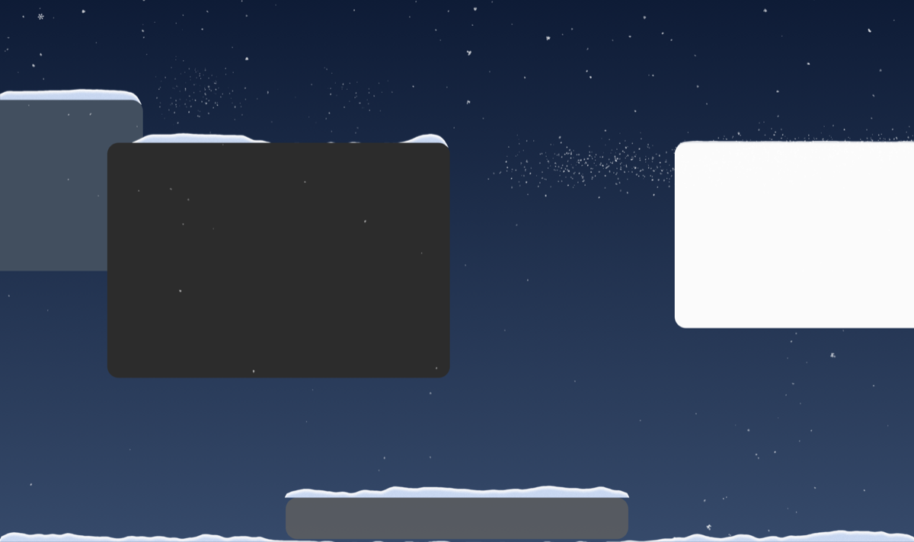
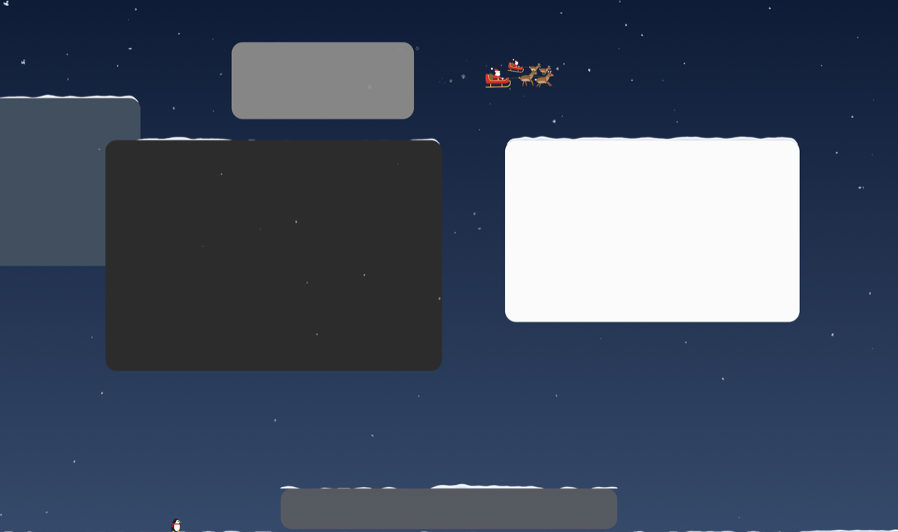
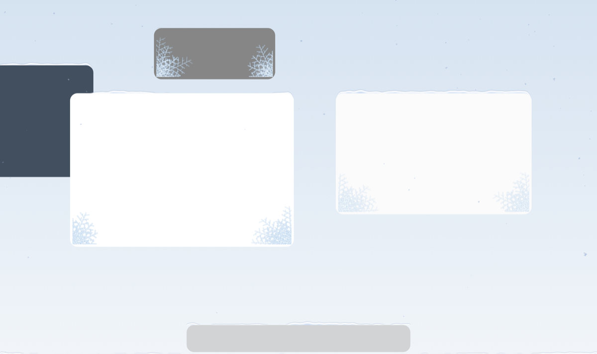

#           ❄︎ WinterIsComing ❄︎

Let it snow on your Mac! ☃️

Snow falls on your desktop, drifts on the wind and piles up on your windows and Dock. Turn on the
festive side and Santa's sleigh follows your cursor, lights hang under the menu bar and frost creeps
into the corners of your windows. Every flake, bell and bulb is drawn or synthesized in code.



| Festive: Santa flyover, cursor sleigh, penguin | Window frost on a light desktop |
|---|---|
|  |  |

The previews come from the built-in snapshot tool (below), which runs the real simulation over a
stand-in desktop.

## What it can do ✨

**Natural winter** (the default)

- 🌨️ **Natural snowfall**: fine specks, small clumps, the occasional big fluffy flake and a rare six-armed crystal
- 🌬️ **Real wind** that varies across the screen, with gusts that travel through it
- 🏔️ **Snow piles up** on your windows, the Dock and the bottom of the screen, unevenly, the way drifts do
- 🪟 **Snow rides your windows**: drag slowly and it comes along, jerk or shake and it breaks off as powder
- 🖥️ **Every display**, one shared weather; ⚓ **any Dock** position, hidden or not
- 💧 **Optional melting**, so piles level off
- 🖱️ **Clicks always pass through**; the cursor stirs nearby flakes

**Festive winter** (all optional, all off until you turn them on)

- 🎅 **Cursor companion**: Santa's sleigh with galloping reindeer, or a Santa hat, beside the real pointer
- ✨ **Cursor trails**: snowflakes, golden sparkles or a festive mix
- 🔔 **Sleigh bells** on cursor movement and flyovers, and 🌬️ **wind ambience**, both synthesized and quiet
- 💡 **Christmas lights** under the menu bar and along the front window, twinkling and glowing on the snow
- 🧊 **Window frost** creeping into the corners of windows that sit still
- 🛷 **Santa flyovers**, 🌠 **shooting stars, gusts and other rare events**
- 🐧 **A penguin** that waddles and slides along the snow at the bottom of each display
- ⛄ **Play Mode**: roll snowballs and build a snowman (only when you switch it on)

**Five themes** set everything up in one go: Quiet Winter, Christmas Eve, Santa's Workshop, Winter
Night and Winter Playground. Adjust anything afterwards; themes leave your sound and performance
choices alone.

## Install and run 🚀

Requires macOS 14 or later and the Swift toolchain (Xcode or the Command Line Tools:
`xcode-select --install`).

```sh
git clone https://github.com/risshhabh/winter-is-coming.git
cd winter-is-coming
zsh Scripts/bundle.sh          # builds WinterIsComing.app (release build, app icon, ad-hoc signed)
open WinterIsComing.app
```

**Or download it** from [Releases](https://github.com/risshhabh/winter-is-coming/releases): unzip,
move `WinterIsComing.app` to `/Applications` and open it. The app is not notarized, so macOS blocks
the first launch: open System Settings → Privacy & Security, scroll down, click **Open Anyway** next
to WinterIsComing, and confirm. (On macOS 14, right-click the app → Open does the same.) Building it
yourself avoids this.

To keep it, drag `WinterIsComing.app` into `/Applications`, open it from there, and tick
**Preferences → General → Launch at login**.

A ❄︎ appears in the menu bar. There is no Dock icon and no window until you open Preferences.

For development, `zsh build.sh` builds and runs from the terminal, and `swift test` runs the tests.

## Configuring ⚙️

The ❄︎ menu has the everyday controls: pause, theme, weather, cursor effect and trail, lights,
bells, mute, Santa and event triggers, Play Mode, clear, **Preferences… (⌘,)** and quit.

Preferences has everything, applied the moment you change it and remembered between launches:

| Tab | Settings |
|---|---|
| Snow | Weather, density, flake size, falling speed, wind, accumulation on/off, accumulation speed, maximum height, melting, snow in front of windows, how much the cursor stirs the snow |
| Cursor | Companion (none, sleigh, hat), companion size, animation intensity, trail, trail intensity |
| Audio | Sleigh bells, bell volume, wind ambience, ambient volume, mute all |
| Decorations | Christmas lights, light brightness and density, window frost, Santa flyovers, atmospheric events, animated characters |
| Performance | Frame-rate limit, particle budget, battery saver, pause on battery, pause in Low Power Mode, follow Reduce Motion |
| General | Launch at login, Dock snow permission |

A theme popup and **Restore Defaults** sit above the tabs.

## Permissions 🔐

- **None are required.** Snow, decorations, cursor effects and sound all work without any permission.
- **Accessibility (optional)** is only used to read where the Dock is, for snow on the Dock. The app
  never asks at launch: use **Preferences → General → Allow Dock Snow…**, enable WinterIsComing in
  System Settings → Privacy & Security → Accessibility, then quit and reopen it.
- It reads the cursor position and the time since the last key press (to step aside while you
  type). It installs no event tap, sees no keystrokes, and cannot delay or block input.
- No network access, no files outside its own preferences, no microphone or screen recording.

## Performance 🔋

Measured with the bundled app on an M4 MacBook on battery (so the default battery saver held it at
30 fps), one display, over 20-second runs:

| | Natural snow | With the cursor sleigh |
|---|---|---|
| CPU (`ps`, one core = 100%) | about 5% | about 5.5% |
| Memory (RSS) | 62–65 MB, steady | 65 MB, steady |
| Simulation step | 0.04 ms | 0.04 ms |
| Sprite updates per frame | 0.1 ms | 0.12 ms |

The work done to keep it there is described in [docs/perf.md](docs/perf.md). Paused, asleep or
locked, it renders and simulates nothing and stops all audio.

## How it is put together 🧩

```
Sources/WinterCore/        the simulation; no AppKit or SpriteKit, fully unit-tested
  AppSettings                every user choice, persistence, clamping, the five themes
  WindField, Weather         wind field, presets, the user's tuning, slow natural variation
  FlakeSystem, PowderSystem  falling flakes; powder, trails and sparkles
  SnowField, SurfaceManager  piles on windows, the Dock and the ground; occlusion; collisions
  WindowKinematics           how a window's velocity and acceleration dislodge its snow
  QualityGovernor            thins the snowfall when frames get expensive
  CursorCompanion            how the sleigh or hat chases the cursor
  BellSequencer, BellSynth   when a bell rings; the synthesized bells and wind
  Atmosphere                 rare events, light-string layout, the wandering penguin's motion
Sources/WinterIsComing/    the app
  AppDelegate, Preferences   menu, settings window, lifecycle, launch at login, auto-pause
  SnowModel                  the one shared winter: fixed-step loop, window polling, per-display flakes
  OverlayController          one click-through overlay per display
  SnowScene, Render/         SpriteKit: textures, particle sprites, the pile shader
  Festive/                   companion, art, sound, lights, frost, penguin
  Play/                      snowballs and snowmen
  WindowSource, DockTracker  where the windows and the Dock are
  Power, AppIcon             battery and thermal state; the icon, drawn in code
Tests/WinterCoreTests/     89 tests
```

## See it without watching the screen 📸

```sh
.build/release/WinterIsComing --snapshot out.png --preset storm --seconds 300
```

This runs the real model headlessly and writes a PNG. Options: `--light`, `--displays 2`,
`--motion shake|jerk|slow|still`, `--lead 1.1`, `--melt`, `--cursor sleigh|hat|none`,
`--trail snow|gold|festive`, `--size 1.35`, `--rest`, `--lights warm|multi`, `--frost`,
`--flyover`, `--events`, `--characters`.

`--smoke 20` runs the live app for 20 seconds with default settings (your saved settings are not
touched) and prints timings and whether every overlay is click-through. `--audition` plays every bell.

## Known limitations 🚧

- **The system cursor cannot be replaced** for other apps, so the sleigh and hat are companions
  drawn beside the real pointer, which keeps its own shape.
- **Everything is drawn in one layer above your windows.** Flyovers, shooting stars and frost pass
  in front of window content, so they are kept small, high up or in corners.
- **The overlay is below the menu bar and Dock**; the companion slides under them.
- **Why a window left the screen** is not reported by macOS. Gone means closed; a Space change at the
  same moment means another Space (snow kept); otherwise minimized or hidden (snow falls). A late
  Space-change notice can be mistaken for a minimize.
- **Window corner radius** is not available; one value per macOS version is used.
- **Window positions are polled** (up to 60 times a second while dragging, 5 at rest), so a pile can
  trail a fast-dragged window by a frame or two, and a window moved by keyboard can take up to 0.2 s
  to be noticed.
- **Mission Control and Stage Manager** scale windows without changing their reported frames.
- **The Dock** can only be found with Accessibility permission. A hidden Dock is recognised by being
  off its display.
- **Displays stacked vertically**: snow does not fall from the upper display onto the lower one.
- **Play Mode** snowballs stay on the display they were made on; the penguin keeps to the bottom of
  its display.
- **Launch at login** needs the bundled app (not `swift run`), ideally in `/Applications`.
- **The app is ad-hoc signed.** macOS may ask for Accessibility again after you rebuild it, and the
  first launch of a downloaded copy must be allowed in System Settings → Privacy & Security → Open Anyway.

## Troubleshooting 🔧

| Problem | Fix |
|---|---|
| No ❄︎ in the menu bar | The menu bar may be full: quit some menu bar apps or hold ⌘ and drag icons to make room. Check it is running with `pgrep -l WinterIsComing`. |
| No snow on the Dock | Preferences → General → Allow Dock Snow…, enable it in System Settings, then quit and reopen. After a rebuild, remove and re-add it there. |
| Snow disappeared | It may be paused (menu says Resume Snow) or auto-paused by a power setting (menu says so). Check Preferences → Performance. |
| Fewer flakes than expected | Snow falls behind windows, so a maximized window hides most of it. Battery saver, Low Power Mode or the particle budget also thin it. |
| No sound | Sound is off by default: Preferences → Audio. Check Mute all sound. Bells only ring while a cursor effect or trail is on, or during a flyover. |
| Launch at login fails | Move the app to /Applications and try again; check System Settings → General → Login Items. |
| "Apple could not verify…" or won't open | System Settings → Privacy & Security → Open Anyway. If macOS says the app is damaged, run `xattr -dr com.apple.quarantine /Applications/WinterIsComing.app`, or build it yourself with `zsh Scripts/bundle.sh`. |
| Settings are wrong | Preferences → Restore Defaults, or `defaults delete local.winteriscoming` while the app is quit. |

The full manual test checklist is in [docs/manual-tests.md](docs/manual-tests.md).

## License

[MIT](LICENSE). Based on [WINTER_IS_COMING](https://github.com/yike-shi/WINTER_IS_COMING) by Shi Yike,
whose original copyright notice is kept in `LICENSE` and whose commit is the root of this
repository's history. · Made with 💙 and a little help from Claude
